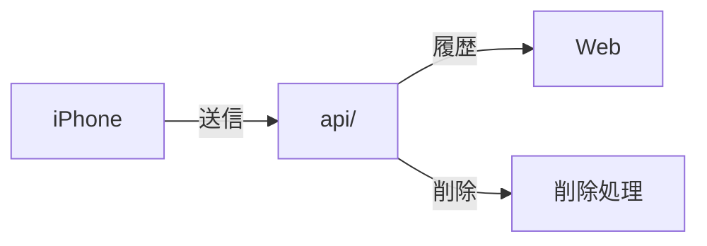

# api/

[English](README-en.md) · [技術](../tech-jp.md) · [セットアップ](../setup-jp.md)

健康データの送信・取得・削除。

公開APIのApp Check・CORS・レート制限と配備前の設定: [Security](SECURITY.md)。

[検証](tests/)

## レート制限

公開履歴の読み取り（`GET /v1/sync-status`、`/v1/samples`、`/v1/summaries`）には、
全利用者で共有する12時間あたり60リクエスト・サンプル読み取り予約100,000件の上限があります。
カウンターはUTCの00:00と12:00（日本時間の09:00と21:00）にリセットされます。
どちらかの上限を超えると、`Retry-After: 43200` 付きのHTTP 429を返します。
キャッシュ済みの集計結果もリクエスト数に含まれますが、サンプル読み取り枠は予約しません。

Firestoreのドキュメント `api_limits/public` にある真偽値フィールド `rateLimited` を
`false` にすると制限を一時的に無効化でき、`true` にすると再び有効になります。
変更は再起動なしで次のリクエストから反映されます。ドキュメントまたはフィールドがない場合は
有効として扱い、次に読み取り枠を正常に予約した際に `rateLimited: true` を保存します。
無効化中も既存のカウンターは保持され、再有効化すると現在の12時間枠の残りを使用します。
カウンターは次のリセット時刻にリセットされます。このフラグはクエリサイズの上限や認証要件には影響しません。

## リアルタイム心拍数

`POST /v1/live` は既存の `UPLOAD_TOKEN` Bearer認証を使います。現在のFirestore公開世代に対して、
`generation`、`session_id`、`started_at`、`sent_at`、`updating`、`heart_rate`、`measured_at` を送信します。
時刻はタイムゾーン付きISO 8601です。`updating: false` の場合は測定値と測定時刻をnullにします。
RTDBの `/live` を上書きし、履歴は保存しません。30秒より古い測定値は公開しません。
遅延した古いワークアウト・更新は新しい状態を上書きできません。

`GET /v1/live` はRTDBの変更をSSEで配信します。公開イベントのフィールドは
`heart_rate`、`updating`、`measured_at`、`updated_at` のみです。接続は40秒で再接続し、
公開停止・世代変更を再確認します。`POST /v1/live/clear` は認証付きで指定世代の現在値を消去します。
Firestore履歴の削除もRTDBを消去します。既存のHealthKit→Firestore履歴保存は独立して継続します。

ライブSSEはHostingのバッファリングを避けるため、公開Cloud Run URLへ直接接続します。
公開読取ストリームだけにCORSを許可しています。更新APIは引き続きBearer認証が必要です。
