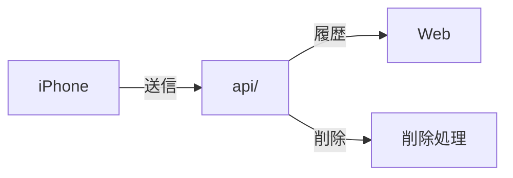

# api/

[English](README-en.md) · [技術](../tech-jp.md) · [セットアップ](../setup-jp.md)

健康データの送信・取得・削除。

[検証](tests/)

## リアルタイム心拍数

`POST /v1/live` は既存の `UPLOAD_TOKEN` Bearer認証を使います。現在のFirestore公開世代に対して、
`generation`、`session_id`、`started_at`、`sent_at`、`updating`、`heart_rate`、`measured_at` を送信します。
時刻はタイムゾーン付きISO 8601です。`updating: false` の場合は測定値と測定時刻をnullにします。
RTDBの `/live` を上書きし、履歴は保存しません。30秒より古い測定値は公開しません。
遅延した古いワークアウト・更新は新しい状態を上書きできません。

`GET /v1/live` はRTDBの変更をSSEで配信します。公開イベントのフィールドは
`heart_rate`、`updating`、`measured_at`、`updated_at` のみです。接続は40秒で再接続し、
公開停止・世代変更を再確認します。`POST /v1/live/clear` は認証付きで指定世代の現在値を消去します。
Firestore履歴の削除もRTDBを消去します。既存のHealthKit→Firestore履歴保存は独立して継続します。

ライブSSEはHostingのバッファリングを避けるため、公開Cloud Run URLへ直接接続します。
公開読取ストリームだけにCORSを許可しています。更新APIは引き続きBearer認証が必要です。
