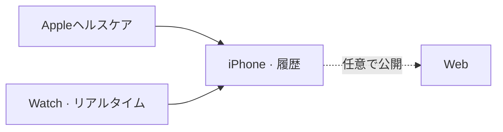

# mobile/ios/Beatavue/

[English](README-en.md) · [技術](../../../tech-jp.md) · [セットアップ](../../../setup-jp.md)

iPhoneで履歴。Watchでリアルタイム心拍。

[iPhone](Beatavue/) · [Watch](<Beatavue Watch Watch App/>) · [Xcode](Beatavue.xcodeproj/)

## ライブ心拍の公開

iPhoneのCloud publishingで接続を保存し、公開を有効にしてから「Publish live workout heart rate」を
有効にします。WatchConnectivityで最新の設定・トークン・公開世代をWatchに転送し、Watch側の
Keychainに保存します。Watchはワークアウト中にAPIへ直接送信し、iPhoneへのミラーリングも継続します。

通信失敗時は最新の状態だけを短時間再試行します。ライブ値は履歴キューに入りません。
ワークアウトのHealthKit保存と既存のiPhone→Firestore同期は従来どおりです。
資格情報の初回転送と切断中の設定変更の反映には、ペアリングされた実機での接続が必要です。
