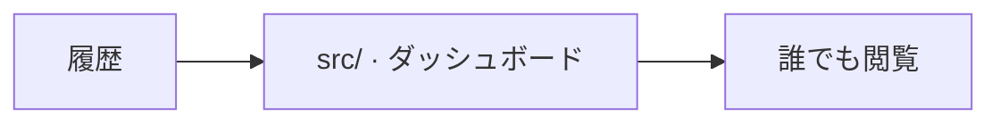

# web/

[English](README-en.md) · [技術](../tech-jp.md) · [セットアップ](../setup-jp.md) · [開く](https://beatavue.web.app)

心拍数・HRVの履歴を公開。

[ソース](src/)

## リアルタイム表示

ライブ心拍セクションは公開Cloud Run APIの `/v1/live` のEventSourceに接続します。
Firebase Hostingはストリームをバッファリングするため、本番のライブ接続先は `web/.env.production` で設定します。APIがRTDBの変更を中継するため、
ブラウザにはアップロードトークン・データベース認証情報を渡しません。
一時停止・終了・切断・30秒を超えた測定値は数値を隠します。英語・日本語に対応しています。
